<p align="center">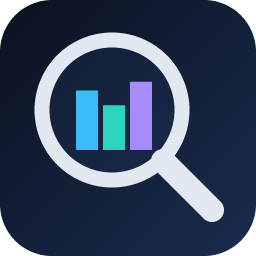</p>

# NetLens

**A dashboard for UniFi networks.** Self-hosted, it shows **who used how much, of what, and
when**, how good each device's **Wi-Fi** is, how your **access points, switches and gateway**
are doing, and what your firewall and intrusion prevention **blocked** — and it keeps that
history, which UniFi itself deletes after a day or a week.

> Not affiliated with, endorsed by, or sponsored by Ubiquiti Inc. UniFi is a trademark of Ubiquiti Inc.

Source, issues and full documentation: **https://github.com/GeorgeAL78/netlens**

## Screenshots

| | |
| --- | --- |
| 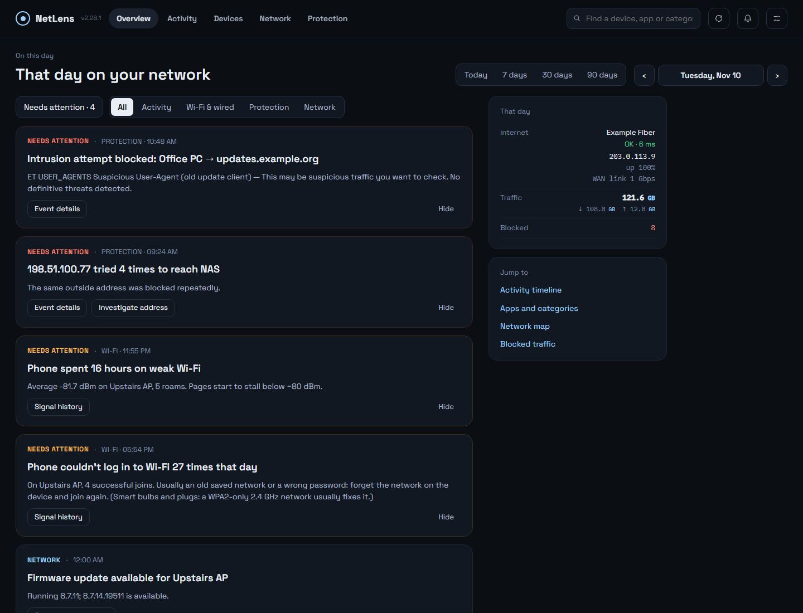 | 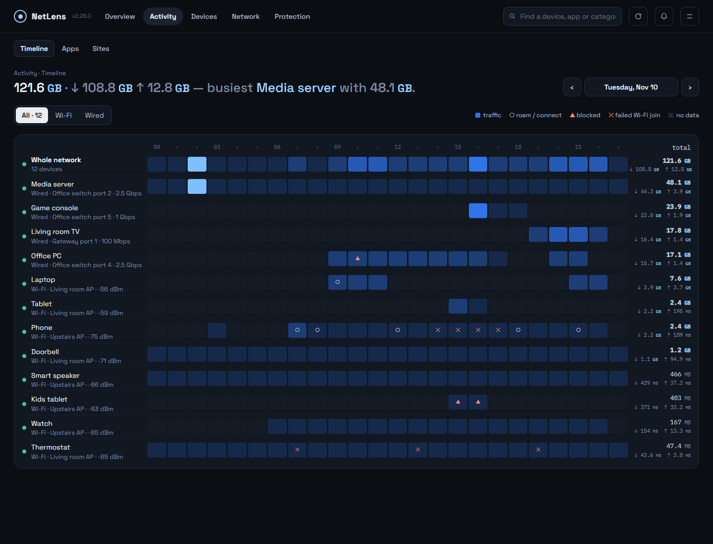 |
| **Overview** — findings in plain language, limits on top | **Activity › Timeline** — every device by hour |
| 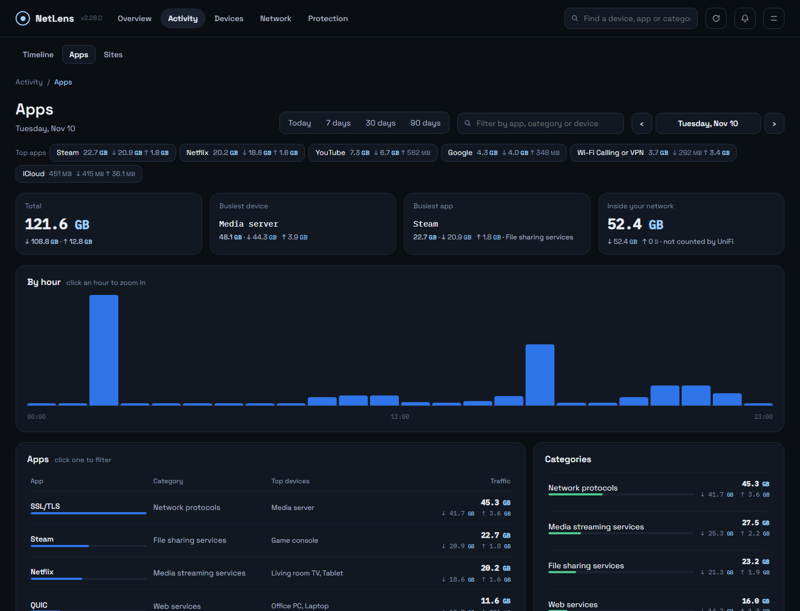 | 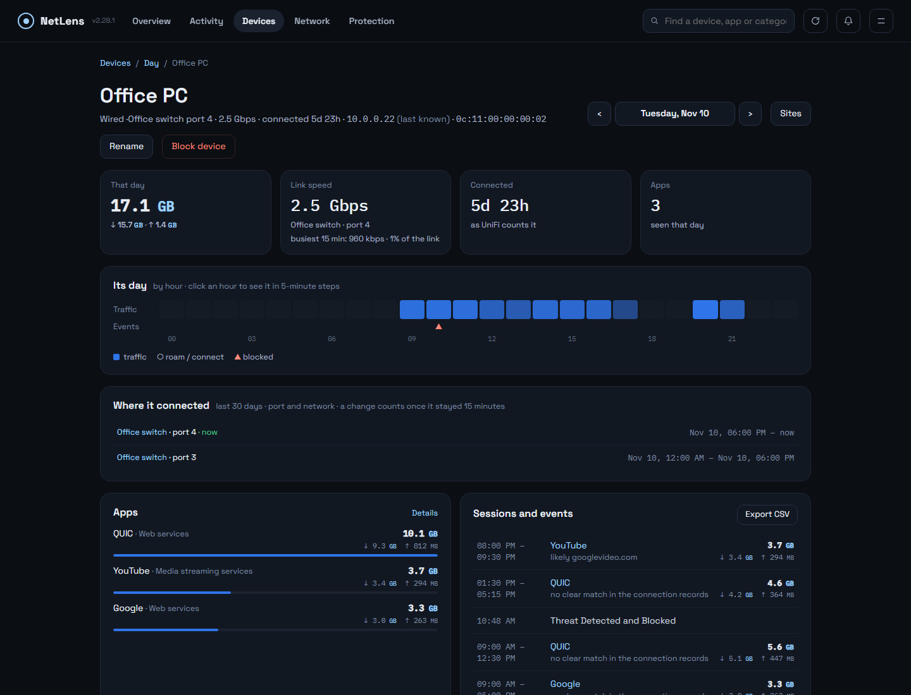 |
| **Activity › Apps** — top apps, search by app, category or device | **Device** — its day, where it connected (port and network), apps, sessions and events |
| 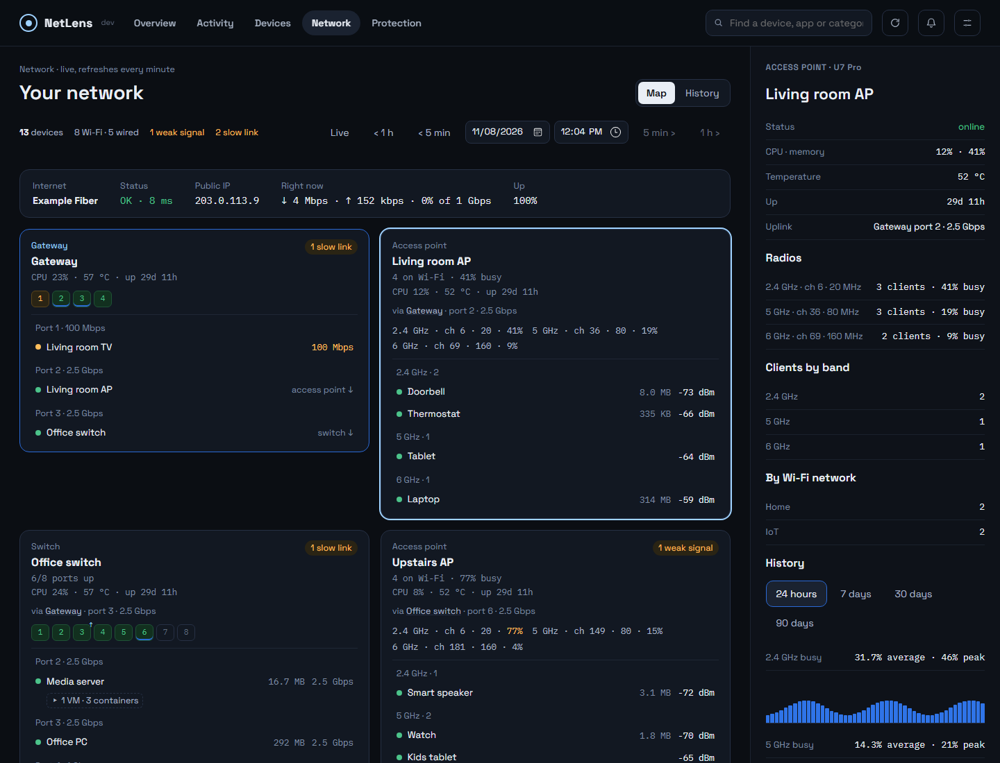 | 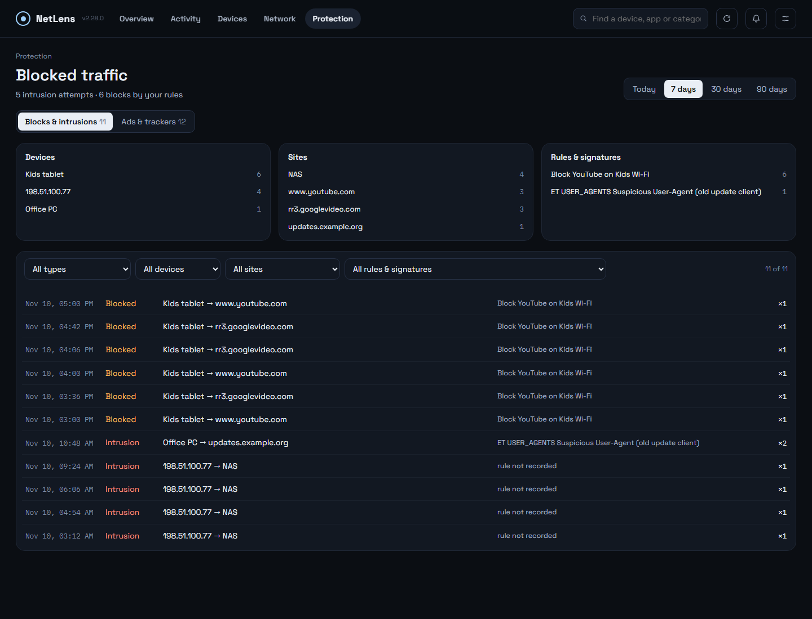 |
| **Network › Map** — a card per gateway, switch and access point; a switch selected: each port's traffic, busiest 5 minutes and dropped packets | **Protection** — every block as one incident, with filters; ads and trackers on their own tab |
| 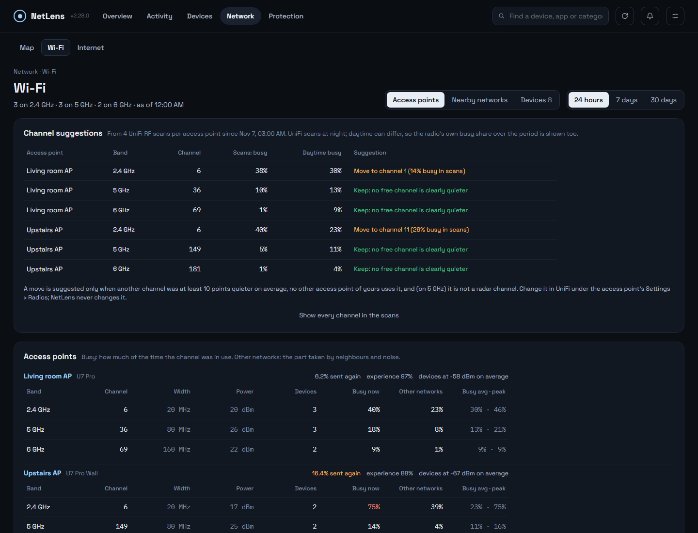 | 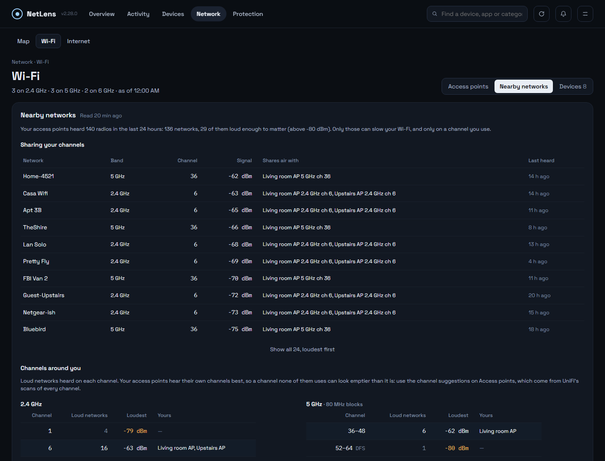 |
| **Network › Wi-Fi** — each radio's channel, load and interference; channel suggestions from UniFi's RF scans | **Network › Wi-Fi › Nearby** — of the hundreds of networks around, the loud ones on your channels |
| 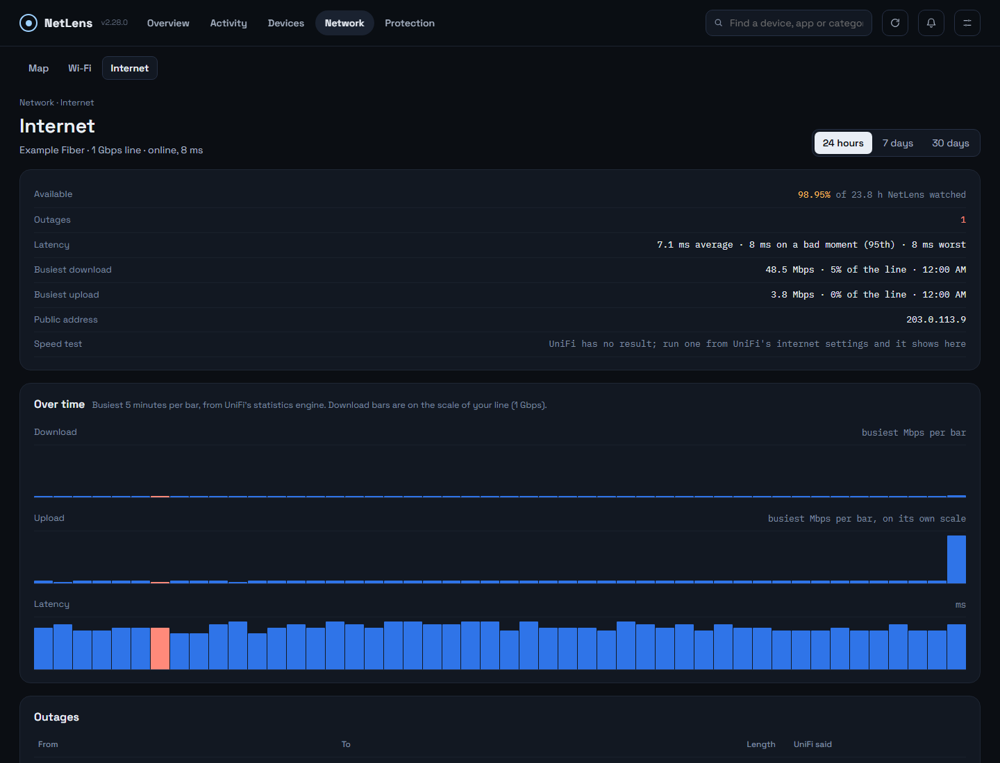 | 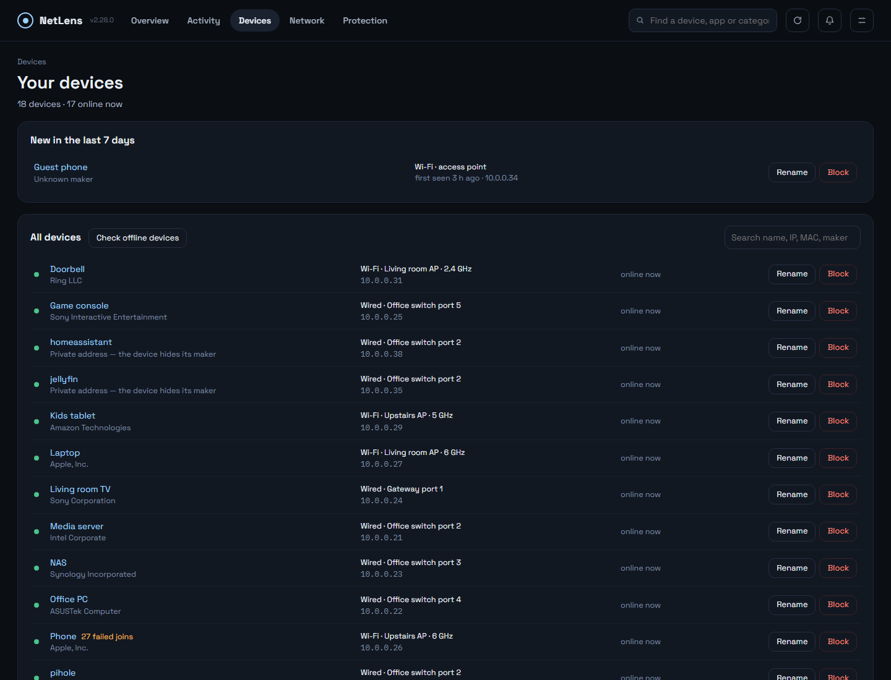 |
| **Network › Internet** — availability, outages, latency per test target, the busiest moments against your line | **Devices** — new devices, maker, switch port or access point, rename |
| 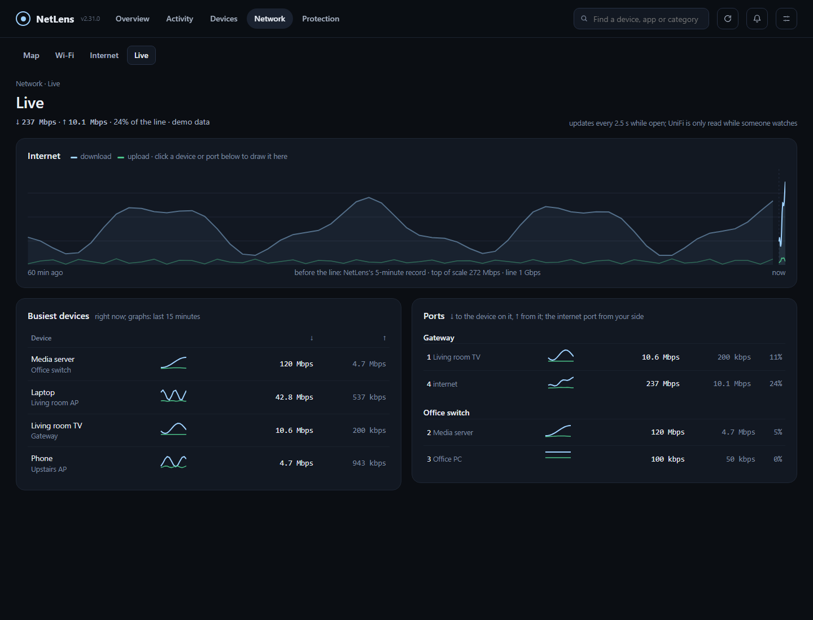 | 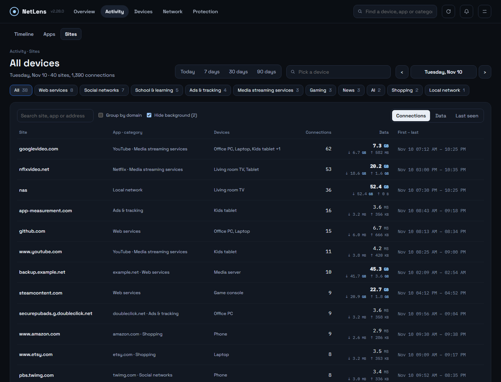 |
| **Network › Live** — the last hour of the line, then live every few seconds; the busiest devices and every port with their own graphs | **Activity › Sites** — every site each device connected to, filtered by category |
| 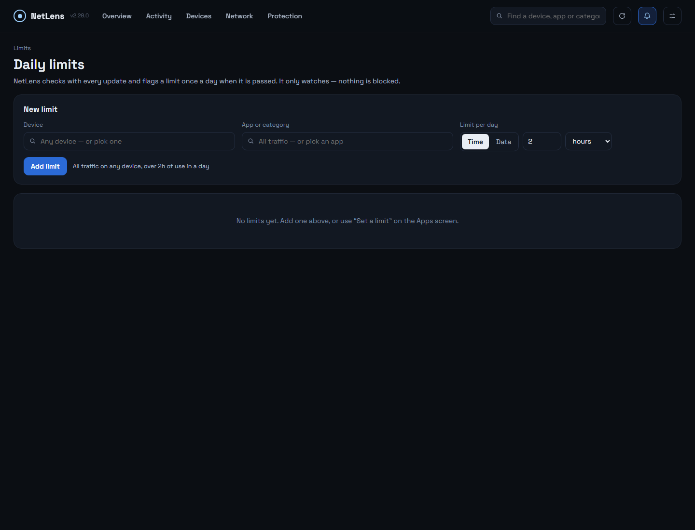 | |
| **Limits** — daily limits per app and device | |

<sub>Screenshots use a made-up demo network, not real data.</sub>

## Features

- **Overview** — today's findings in plain language: big transfers, weak Wi-Fi, slow links, blocked
  threats, new devices, equipment problems.
- **Activity › Timeline** — devices × hours: when each device was busy, roamed or got blocked.
- **Network › Map** — a card per gateway, switch and access point with ports, Wi-Fi band and signal, VMs and containers under their host; each port's traffic, busiest 5 minutes and dropped packets; the network at any time in the last 90 days, and its history.
- **Network › Wi-Fi** — each radio's channel, load and interference, channel suggestions from UniFi's RF scans, the nearby networks loud enough to share your channels (sifted from hundreds), and every Wi-Fi device's signal, band, roams and failed joins.
- **Network › Live** — the line over the last hour then live every few seconds, the busiest devices and every port with their own graphs; small live graphs on Overview and the Network map.
- **Network › Internet** — availability, every outage, latency per test target, the busiest download and upload against your line, public-address history and speed tests.
- **Moves and equipment** — a device moving to another port or network is noted and listed on its page; restarts, outages and firmware updates of your UniFi equipment over any period.
- **Device** — traffic, signal or link speed, where it connected (port and network), apps, sessions, events, online history, block / unblock.
- **Devices** — new devices first, with maker and switch port or access point; rename (saved in UniFi);
  offline devices checked on the network every 5 minutes; blocked devices listed with Unblock;
  failed Wi-Fi joins per device with the usual cause.
- **Activity › Sites** — every site each device connected to (30 days), filtered by category; addresses hidden
  by secure DNS named when they belong to a watched site.
- **Limits** — daily limits on time or data for an app on a device, flagged on Overview.
- **Protection** — every block as one incident (intrusions, your firewall rules and app blocks), with filters; ads and trackers on their own tab.
- **Activity › Apps** — apps, categories and devices for a day, an hour or 90 days, one search box for all
  three; every number adds up.
- Local-network traffic shown separately; missing data marked, never shown as a quiet hour.
- **API and AI access**: an MCP endpoint at `/mcp` for Claude and other assistants, and a REST
  API described at `/api/openapi.json`. Read everything; with a full access key also make safe
  changes (rename a device, alerts, refresh). It can never block devices or change settings.

## Requirements

- A **UniFi OS console** (UDM, UDM Pro/SE, UCG Ultra/Max/Fiber, UDR, Cloud Key Gen2+).
- A **local API key**: UniFi Network → Settings → Control Plane → Integrations → *Create API Key*.
- The container must be able to reach the console.

## Run

```bash
docker run -d --name netlens --restart unless-stopped \
  -p 3780:3780 \
  -v /path/to/netlens-data:/data \
  gjergjk/netlens:latest
```

Open `http://<host>:3780`. A short setup asks for the console address, the API key, the site,
your timezone and a login password; everything can be changed later in Settings.

**Unraid:** search **NetLens** in Community Applications.

## Tags

| Tag | |
| --- | --- |
| `latest` | newest release |
| `X.Y.Z` | a specific release |
| `beta` | test builds |

Platforms: `linux/amd64`, `linux/arm64`. Also on GHCR: `ghcr.io/georgeal78/netlens`.

## Data

Everything lives in `/data`: settings, history (SQLite) and logs. Keep it on persistent
storage so updates never lose history. **Settings → History** exports everything to one file
and imports such a file — for backups, restores or moving to another server.

| Port | |
| --- | --- |
| `3780/tcp` | web UI |
| `5514/tcp+udp` | syslog listener for ad-block counts (on by default; point UniFi's SIEM server here) |

Forgot the password? Start once with `NETLENS_RESET_PASSWORD=1`, set a new one in the
browser, then remove the variable.

## Security

Meant for your LAN — do not expose it to the internet; use a VPN to reach it remotely. The
API key never leaves the server. Passwords are stored as scrypt hashes; five wrong attempts
lock that address out for five minutes.

## License

GPL-3.0 — https://github.com/GeorgeAL78/netlens/blob/main/LICENSE
